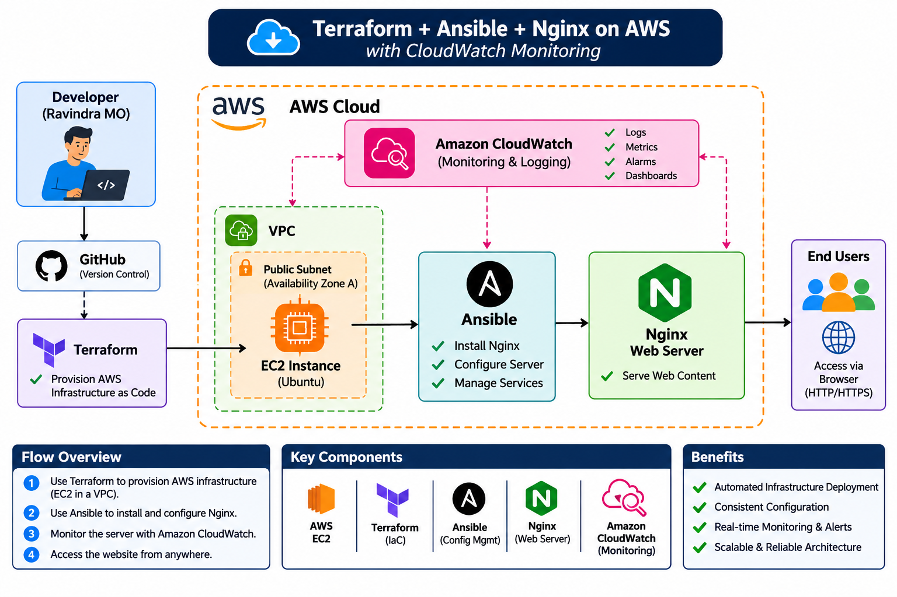

# Terraform + Ansible + Nginx Automation on AWS

## Project Overview

This project demonstrates Infrastructure as Code (IaC) and configuration management by provisioning AWS infrastructure using **Terraform** and automating Nginx installation and configuration using **Ansible**.

The objective is to automate infrastructure deployment and web server configuration, reducing manual intervention and ensuring consistency.

## Architecture Diagram

The following architecture illustrates the end-to-end infrastructure automation workflow using Terraform, Ansible, AWS EC2, Nginx, and Amazon CloudWatch.



### Architecture Workflow

1. **GitHub:** Stores Terraform and Ansible project files.
2. **Terraform:** Provisions AWS infrastructure.
3. **AWS EC2:** Hosts the Ubuntu server inside a VPC.
4. **Ansible:** Connects to EC2 through SSH and automates Nginx installation and configuration.
5. **Nginx:** Serves web content to end users over HTTP/HTTPS.
6. **Amazon CloudWatch:** Collects monitoring metrics and logs, and supports alarms and dashboards.

## Architecture

```text
                 Developer
                     |
                     |
                Terraform
                     |
                     |
                AWS Cloud
                     |
                  EC2 Instance
                     |
                  SSH Access
                     |
                   Ansible
                     |
              Nginx Installation
                     |
                Nginx Web Server
                     |
                HTTP Traffic
                     |
                  End User
```

## Technologies Used

| Technology | Purpose |
|---|---|
| AWS EC2 | Cloud infrastructure |
| Terraform | Infrastructure provisioning |
| Ansible | Configuration management |
| Nginx | Web server |
| Linux / Ubuntu | Operating system |
| Git & GitHub | Version control |

## Project Structure

```text
TERRAFORM-ANSIBLE-NGINX/
│
├── main.tf
├── nginx-playbook.yml
├── inventory.ini
├── .terraform.lock.hcl
├── .gitignore
└── README.md
```

## Implementation Steps

### 1. Infrastructure Provisioning with Terraform

- Configured AWS provider.
- Defined infrastructure using Terraform.
- Provisioned AWS EC2 resources.
- Used Terraform to manage infrastructure as code.

### 2. Configuration Management with Ansible

- Configured EC2 inventory.
- Established SSH connectivity.
- Created Ansible playbook.
- Automated Nginx installation and configuration.

### 3. Nginx Deployment

- Installed Nginx on the EC2 instance.
- Configured the web server.
- Validated Nginx service status.
- Tested web server accessibility.

## How to Run

**Prerequisites**
- AWS account
- Terraform installed
- Ansible installed
- AWS credentials configured
- SSH key pair

**Step 1: Initialize Terraform**

```bash
terraform init
```

**Step 2: Validate Terraform configuration**

```bash
terraform validate
```

**Step 3: Preview infrastructure**

```bash
terraform plan
```

**Step 4: Deploy infrastructure**

```bash
terraform apply
```

**Step 5: Configure Ansible inventory**

Update `inventory.ini` with the EC2 public IP and SSH connection details.

**Step 6: Run Ansible playbook**

```bash
ansible-playbook -i inventory.ini nginx-playbook.yml
```

**Step 7: Verify Nginx**

```bash
systemctl status nginx
```

Access the EC2 public IP in your browser to verify the web server.

## Key Learnings

- Infrastructure provisioning using Terraform.
- AWS EC2 deployment and management.
- Configuration management using Ansible.
- SSH-based remote server administration.
- Automated Nginx installation.
- Infrastructure automation and version control.

## Author

**Ravindra MO**

- GitHub: https://github.com/RavindraM0
- Portfolio: https://devops-portfolio-taupe.vercel.app

---

⭐ If you find this project useful, feel free to explore the repository.
